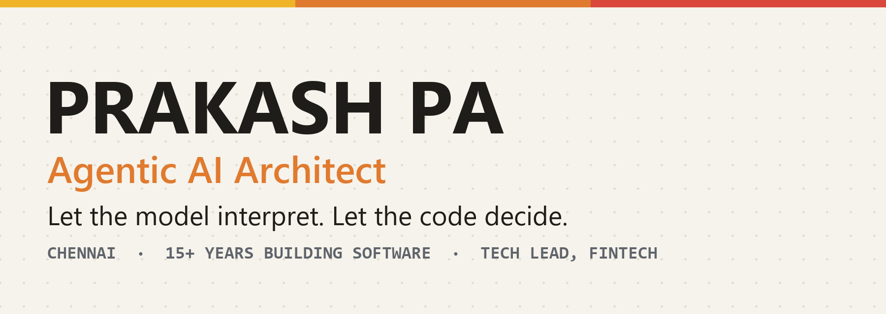
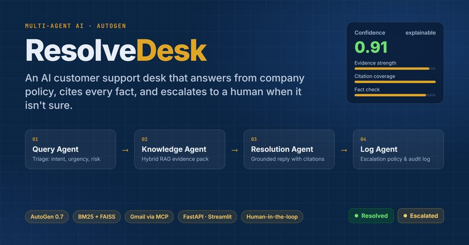
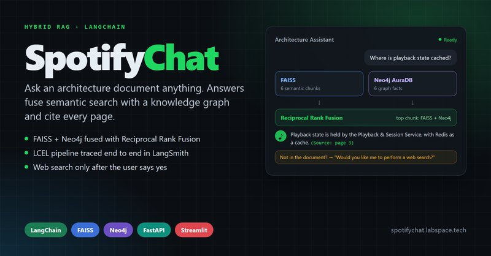
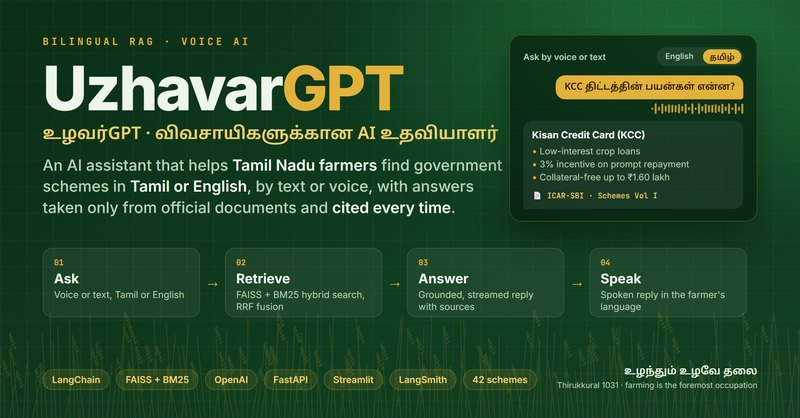
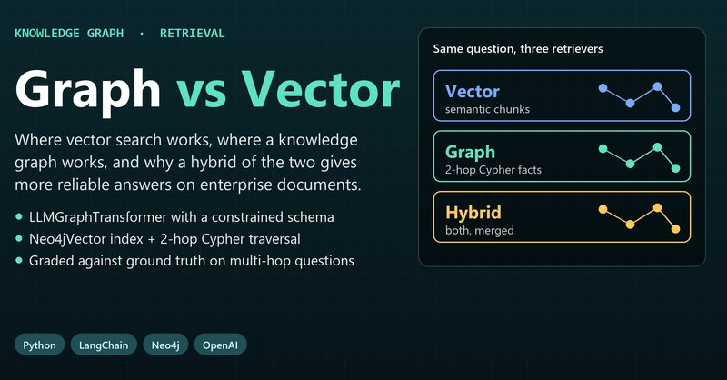
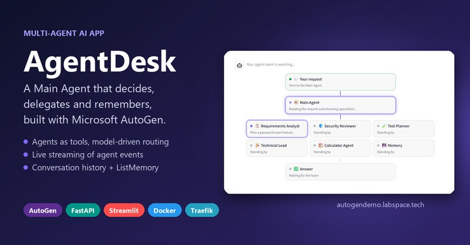
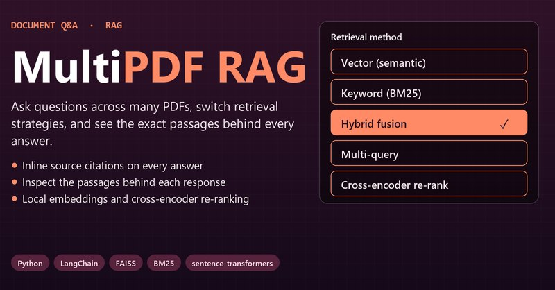

<picture>
  <source media="(prefers-color-scheme: dark)" srcset="assets/banner-dark.png">
  
</picture>

  
  
  

## Hi, I'm Prakash

I'm an AI architect who still builds what I design, with 15+ years of building software products behind me.

Since 2020 I've been technical lead on **InsideArbitrage**, a fintech research platform with 50K+ registered users. There I take Generative AI features from idea to production:

- AI-written portfolio reports that are **fact-checked against SEC and market data** before they reach subscribers
- One LLM layer across four providers, with database-managed prompts, caching and per-request cost tracking
- LLM pipelines that turn SEC filings and press releases into validated, structured data

That code is private. What you'll find here is the work I do on my own time.

## Nobody asked me to build these

<table>
  <tr>
    <td width="50%" valign="top">
      
      <h3><a href="https://github.com/prakashpa-codes/autogen-ai-customer-support-desk">ResolveDesk</a></h3>
      Four AutoGen agents read each complaint, check company policy, and resolve it or hand it to a person with a reason. Confidence is calculated in code from the evidence, never self-reported by the model.
        AutoGen · MCP · FastAPI · FAISS + BM25 · Docker
    </td>
    <td width="50%" valign="top">
      
      <h3><a href="https://github.com/prakashpa-codes/spotifychat-hybrid-rag">SpotifyChat</a></h3>
      Vector search fused with a Neo4j concept graph. Falls back to vector-only search if the graph is down, and searches the web only after the user says yes.
        LangChain · FAISS · Neo4j · LangSmith · Docker
    </td>
  </tr>
  <tr>
    <td width="50%" valign="top">
      
      <h3><a href="https://github.com/prakashpa-codes/uzhavar-gpt">Uzhavar GPT</a></h3>
      Helps Tamil Nadu farmers find government schemes by text or voice, in Tamil or English. On a 20-question bilingual test set, the right source was in the top 8 every time.
        LangChain · FAISS + BM25 · FastAPI · OpenAI speech
    </td>
    <td width="50%" valign="top">
      
      <h3><a href="https://github.com/prakashpa-codes/hybrid-graph-vector-rag-demo">Graph vs Vector</a></h3>
      Vector, graph and hybrid retrieval side by side on Neo4j, graded against ground truth on multi-hop and numeric questions.
        LangChain · Neo4j · OpenAI
    </td>
  </tr>
  <tr>
    <td width="50%" valign="top">
      
      <h3><a href="https://github.com/prakashpa-codes/autogen-multiagent-docker-agentdesk">AgentDesk</a></h3>
      A main agent decides which specialists a request needs, delegates to them as tools and combines their answers. The UI shows each agent working in real time.
        AutoGen · FastAPI · Docker · Traefik
    </td>
    <td width="50%" valign="top">
      
      <h3><a href="https://github.com/prakashpa-codes/multipdf-rag-assistant">Multi-PDF RAG</a></h3>
      Q&A across many PDFs with switchable retrieval: vector, BM25, hybrid fusion, multi-query and cross-encoder re-ranking. Every answer cites its sources.
        LangChain · FAISS · BM25 · sentence-transformers
    </td>
  </tr>
</table>

## How I build

- **Start simple.** A plain workflow first; an agent only where a step needs judgment.
- **The model reads and drafts. Code validates, scores and acts.**
- **Measure before choosing.** Retrieval and orchestration choices are tested on labelled questions, not picked by habit.
- **Safe by default.** Least-privilege tools, PII masking, and a person in the loop where a mistake would cost something.

## Tools I work with

Before AI, I spent a decade building PHP and full-stack products for US clients in finance, healthcare and education. That's why I treat data, integrations and security as part of the AI system, not an afterthought.
